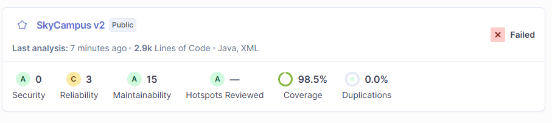
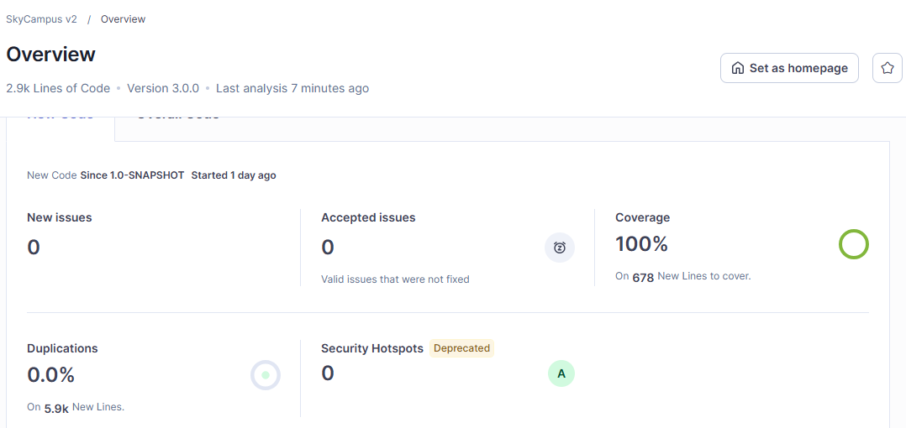

# Infernape · Reto 13 — Quality Gate de Enterprise con SonarQube y JaCoCo
Estudiante: Julian Felipe Morales Zambrano

## Qué se pide

Configurar el Quality Gate de Enterprise con los estándares de la tabla del reto, analizar el proyecto con SonarQube y dejar los 6 indicadores en verde. Por cada issue: identificar la causa raíz, corregirla con refactorización o con una prueba adicional (nunca suprimiéndola) y documentar el commit con el que se solucionó.

**Resultado:** el análisis inicial encontró 18 issues y 146 minutos de deuda técnica. Tras las correcciones, el gate `SkyCampus Infernape` pasa con sus 6 condiciones en verde, 0 issues abiertas y 0 minutos de deuda.

## 1. El Quality Gate de Enterprise

Se crea con el script `scripts/configurar-quality-gate.ps1`, que ahora recibe el nivel (`-Nivel Monferno` por defecto, o `-Nivel Infernape`). El token se toma de `$env:SONAR_TOKEN` y nunca se escribe en el archivo.

| # | Indicador | Meta de Enterprise | Condición en SonarQube (falla si...) |
|---|---|---|---|
| 1 | Line coverage | ≥ 85 % | `line_coverage` menor que 85 |
| 2 | Branch coverage | ≥ 75 % | `branch_coverage` menor que 75 |
| 3 | Bugs | 0 | `bugs` mayor que 0 |
| 4 | Vulnerabilidades | 0 | `vulnerabilities` mayor que 0 |
| 5 | Deuda técnica | < 15 min | `sqale_index` mayor que 14 |
| 6 | Duplicación | < 3 % | `duplicated_lines_density` mayor que 2,99 |

Dos decisiones de lectura: "menos de 15 minutos" se evalúa como "falla desde 15" (la deuda se mide en minutos enteros, por eso el umbral es 14), y "menos de 3 %" como "falla desde 3 %" (umbral 2,99).

**Condiciones sobre código nuevo.** Al crear el gate, SonarQube agregó por su cuenta tres condiciones que no estaban en la tabla (`new_coverage`, `new_duplicated_lines_density` y `new_violations`). Como el reto pide exactamente 6 y todas sobre el código completo, el script las elimina después de crear el gate (commit `d474234`). Con esto el gate queda con las 6 condiciones y ninguna otra.

### Evolución de los estándares en los 3 niveles

| Métrica | MVP (Chimchar) | V2 (Monferno) | Enterprise (Infernape) | Resultado real |
|---|---|---|---|---|
| Line coverage | 80 % | 80 % | ≥ 85 % | 97,9 % |
| Branch coverage | — | 70 % | ≥ 75 % | 100 % |
| Bugs | 0 | 0 | 0 | 0 |
| Vulnerabilidades | 0 | 0 | 0 | 0 |
| Deuda técnica | 0 | < 30 min | < 15 min | 0 min |
| Duplicación | — | < 5 % | < 3 % | 0,0 % |

**El build también exige cobertura.** Aparte del gate de SonarQube, el `pom.xml` configura la regla de JaCoCo (`jacoco:check`) con mínimo de 0,85 en líneas y 0,85 en ramas, así que `mvn verify` falla si la cobertura baja de eso. Esa regla ya era más estricta que lo que pide Enterprise (85 % y 75 %) y no se tocó. El código de `app/` (las demos) queda fuera de la cobertura, como en el nivel anterior.

## 2. Estado inicial



| Indicador | Valor inicial |
|---|---|
| Issues abiertas | 18 (3 de fiabilidad y 15 de mantenibilidad; todas de tipo code smell) |
| Bugs | 0 |
| Vulnerabilidades | 0 |
| Deuda técnica | 146 min |
| Line coverage | 97,9 % |
| Branch coverage | 100 % |
| Duplicación | 0,0 % |
| Estado del gate | ERROR (la deuda de 146 min supera el máximo de 14) |

La cobertura y la duplicación ya cumplían. El gate fallaba únicamente por la deuda técnica de las 18 issues.

### Hallazgo previo: una prueba inestable

Antes del análisis, `mvn clean verify` falló en una prueba: `RequisitosEnterpriseTest.rnf08_planificarConVeinteEstaciones_tardaMenosDe500ms` tardó unos 2 segundos contra un límite de 500 ms. Eso no era un defecto del algoritmo: planificar con 20 estaciones solo arma 21 rutas candidatas. La causa fue la medición. La primera llamada de la JVM carga clases y lambdas (con el agente de JaCoCo instrumentando el código) y el equipo estaba cargado con SonarQube y Docker en marcha (el build tardó unos 7 minutos).

**Corrección:** la prueba hace ahora una llamada de calentamiento sin cronómetro y después mide. El límite de 500 ms del RNF-08 no se cambió, y el calentamiento también verifica que exista la ruta. Commit `2ca2b4a`.

## 3. Las 18 issues y cómo se resolvieron

Ninguna se resolvió con `@SuppressWarnings`, `//NOSONAR` ni marcándola como falso positivo o "no se arreglará".

| # | Regla | Archivo : línea | Causa raíz | Corrección | Commit |
|---|---|---|---|---|---|
| 1 | S5778 | `CrearMisionTest` : 240 | La lambda de `assertThrows` tenía dos constructores y no se sabe cuál lanza la excepción | Los objetos se crean antes; la lambda queda con una sola llamada | `ab9772a` |
| 2 | S5778 | `CrearMisionTest` : 242 | Igual que la anterior | Igual que la anterior | `ab9772a` |
| 3 | S106 | `MisionesApiApp` : 30 | La demo se saltó la salida única del proyecto (`util.Consola`) | Imprime con `Consola.imprimir(...)` | `7efa08d` |
| 4 | S1612 | `MisionesApiApp` : 30 | La lambda solo llamaba a `System.out.println` | Desaparece al usar `Consola.imprimir(evento.toString())` | `7efa08d` |
| 5 | S106 | `MisionesApiApp` : 34 | El mensaje de arranque usaba `System.out` directamente | Imprime con `Consola.imprimir(...)` | `7efa08d` |
| 6 | S9358 | `MisionesApi` : 104 | El operador `?:` repetía la llamada `m.group(...)` en sus dos ramas | El condicional elige el número de grupo y se llama una sola vez a `group` | `375f37f` |
| 7 | S9142 | `EspecificacionTokensTest` : 72 | `replaceAll` recompila la expresión en cada vuelta del bucle | Constante `Pattern` compilada una sola vez | `745a848` |
| 8 | S8786 | `DesignTokensTest` : 50 | Expresión de declaraciones CSS con el comienzo `[a-z-]+` sin límite: puede retroceder de forma cuadrática | Cuantificadores acotados `{1,60}`, `{0,20}` y `{1,500}` (ver nota) | `e1173a8`, `1558ebd`, `0f4e749` |
| 9 | S8786 | `DesignTokensTest` : 53 | Etiqueta HTML con `[a-z0-9]+` seguido de `[^>]*`: los dos cuantificadores se solapan | Cuantificadores posesivos `++` y `*+` | `e1173a8` |
| 10 | S6126 | `DesignTokensTest` : 151 | CSS de prueba armado concatenando cadenas | Bloque de texto | `d7d0b05` |
| 11 | S9142 | `DesignTokensTest` : 239 | `String.matches` recompila la expresión en cada vuelta | Constante `ESTILO_NIVEL` | `745a848` |
| 12 | S9142 | `DesignTokensTest` : 297 | `replaceAll` recompila la expresión en cada vuelta | Constante `ATRIBUTO_SEDE` | `745a848` |
| 13 | S1135 | `TemaSede` : 13 | Falso positivo del idioma: "Es **todo** lo que un equipo define" se lee como una tarea pendiente | Se reescribió el comentario ("Es lo único que...") | `7719922` |
| 14 | S8786 | `TemaSede` : 42 | Declaraciones CSS con `\s*` seguido de `[^;]+`, que se solapan | Se quitó el `\s*` redundante; el valor ya se recorta con `trim()` al usarlo | `e1173a8` |
| 15 | S6126 | `TemaSedeTest` : 44 | CSS de prueba armado concatenando cadenas | Bloque de texto | `d7d0b05` |
| 16 | S1130 | `MatrizTrazabilidadTest` : 161 | `throws IOException` en una prueba que ya captura la excepción dentro de la lambda | Se quitó la declaración | `910fbd0` |
| 17 | S5778 | `PlanificadorYGestorTest` : 94 | Dos constructores dentro de la lambda de `assertThrows` | El criterio se crea antes; la lambda queda con una sola llamada | `ab9772a` |
| 18 | S6206 | `RutaCompuesta` : 12 | La clase solo guarda y valida sus etapas | Pasa a ser un `record`; la validación y la copia defensiva van en el constructor compacto | `438d5a2` |

### Notas sobre las correcciones que no fueron directas

- **S8786 en la línea 50 necesitó tres intentos.** El primero (`e1173a8`) quitó el `\s*` repetido; SonarQube siguió marcándola. El segundo (`1558ebd`) agregó una condición de inicio de palabra con `(?<![a-z-])`; SonarQube sigue sin tratarla como ancla y la regla siguió abierta. El tercero (`0f4e749`) acota los cuantificadores, y con eso dejó de aparecer. Antes de cambiarla se comprobó contra los 7 archivos CSS de `docs/diseno` (14 lecturas, 406 declaraciones) que la expresión nueva da exactamente las mismas coincidencias que la original; el valor más largo mide 67 caracteres y el nombre más largo 21, muy por debajo de los límites.
- **S9358:** la corrección se basó en leer la regla como "no repitas la llamada en las dos ramas del condicional". El siguiente análisis confirmó que la issue desapareció.
- **S1135 era un falso positivo del idioma** (la palabra española "todo" en un comentario), pero se resolvió reescribiendo el comentario, no marcándola.
- **`RutaCompuesta` como `record`:** cambia la igualdad (ahora compara las etapas por valor, antes era por identidad). Se revisaron los usos de la clase (solo `PlanificadorRutas` y sus pruebas) y ninguno compara rutas compuestas ni las usa como clave de una colección; `RutaCompuestaTest` sigue cubriendo la copia defensiva, la lista inmodificable y el encadenamiento de etapas.

## 4. Estado final



Resultado del análisis final con el gate `SkyCampus Infernape` (estado **OK**):

| Indicador | Meta | Resultado | Estado |
|---|---|---|---|
| Line coverage | ≥ 85 % | 97,9 % | OK |
| Branch coverage | ≥ 75 % | 100 % | OK |
| Bugs | 0 | 0 | OK |
| Vulnerabilidades | 0 | 0 | OK |
| Deuda técnica | < 15 min | 0 min | OK |
| Duplicación | < 3 % | 0,0 % | OK |

La consulta de issues abiertas devuelve una lista vacía.

## 5. Cómo reproducirlo

Con SonarQube en `http://localhost:9000` y un token generado en *My Account → Security*:

```powershell
$env:SONAR_TOKEN = "<tu token>"
mvn clean verify
.\scripts\configurar-quality-gate.ps1 -Nivel Infernape
mvn org.sonarsource.scanner.maven:sonar-maven-plugin:sonar "-Dsonar.host.url=http://localhost:9000" "-Dsonar.token=$env:SONAR_TOKEN" "-Dsonar.ws.timeout=600"
```

El gate se evalúa en cada análisis, por eso se crea antes de analizar. Para ver el estado y las condiciones:

```powershell
$h = @{ Authorization = "Bearer $env:SONAR_TOKEN" }
$s = (Invoke-RestMethod -Headers $h "http://localhost:9000/api/qualitygates/project_status?projectKey=skycampus-v2").projectStatus
$s.status
$s.conditions | Select metricKey, status, actualValue, errorThreshold | Format-Table -AutoSize
```

## 6. Límites

- **Hay una supresión que ya existía antes de este reto.** `util/Consola.java` tiene `@SuppressWarnings("java:S106")` desde el nivel Monferno, porque esa clase es la única salida por consola del proyecto y es el único lugar con `System.out`. El reto de Enterprise dice "nunca suprimiendo el issue"; esta supresión no se introdujo ni se usó para ninguna de las 18 issues, pero sigue en el código. Si se quiere eliminar, habría que cambiar `Consola` para que escriba por un `Logger` y adaptar las pruebas que capturan la salida.
- **Las dos capturas son del dashboard de SonarQube en Docker en la máquina del estudiante.** El revisor puede reproducir el resultado con los comandos de la sección 5.
- **SonarQube no se pudo ejecutar fuera de esa máquina.** Por eso, en las correcciones de S8786 y S9358 se probó cada intento con un análisis real y no con una herramienta externa.
- **Los resultados dependen de la versión de SonarQube:** reglas recientes como S8786, S9142 y S9358 aparecen en versiones nuevas; con otra versión, la lista inicial de issues podría ser distinta.
